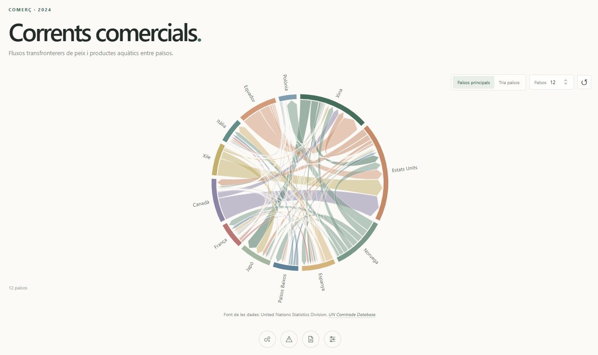

# Corrents comercials

Diagrama de cordes interactiu per explorar els fluxos comercials internacionals de peix i productes aquàtics l'any 2024. La visualització utilitza les dades d'exportació del codi HS 03 de la base de dades **UN Comtrade** i presenta els països i les seves connexions en una interfície minimalista en català.




## Funcionalitats

- **Països principals:** introdueix el nombre de països que vols representar al diagrama.
- **Selecció manual:** cerca i selecciona els països que vols explorar.
- **Exploració de les connexions:** passa el cursor per damunt d'una corda per consultar el país d'origen, el país de destinació i el valor declarat.
- **Resum per país:** selecciona un segment o una etiqueta per consultar informació agregada sobre els fluxos i els principals socis visibles.
- **Informació metodològica:** les icones situades sota el diagrama despleguen informació sobre la visualització, les limitacions, la font de les dades i el tractament aplicat.

## Tecnologies

- **HTML5** per a l'estructura de la pàgina.
- **CSS3** per al disseny, la paleta de colors i l'adaptació a diferents mides de pantalla.
- **JavaScript** per a la lògica i les interaccions.
- **D3.js** per generar el diagrama de cordes.

D3.js es carrega des d'un CDN; cal disposar de connexió a internet perquè la visualització funcioni completament.

## Estructura del projecte

```text
chord-trade-github/
├── index.html
├── README.md
├── css/
│   └── style.css
├── js/
│   ├── app.js
│   ├── country-ca.js
│   └── trade-data.js
├── data/
│   └── trade_flows.json
└── assets/
    └── corrents-comercials.png
```

- `index.html`: estructura de la pàgina i controls de la visualització.
- `css/style.css`: estils, tipografia, colors, distribució i adaptació a pantalles petites.
- `js/app.js`: prepara les dades, construeix la matriu de fluxos i gestiona les interaccions del diagrama.
- `js/country-ca.js`: noms de països en català.
- `js/trade-data.js`: dades incorporades al JavaScript per facilitar l'obertura local de la pàgina.
- `data/trade_flows.json`: dades comercials en format JSON.
- `assets/corrents-comercials.png`: captura de pantalla que es mostra en aquest README.


## Procedència i tractament de les dades

**Font:** [United Nations Comtrade (UN Comtrade)](https://comtradeplus.un.org/), base de dades d'estadístiques de comerç internacional de les Nacions Unides.

**Període i producte:** s'utilitzen registres d'exportacions de 2024 corresponents al codi de producte HS 03, que inclou peix, crustacis, mol·luscos i altres invertebrats aquàtics.

**Tractament i agregació:** s'han exclòs els registres agregats de l'àmbit mundial (*World*) per evitar barrejar totals globals amb fluxos bilaterals. Cada registre conservat es representa com una connexió dirigida entre un país exportador i un país importador. El pes de la connexió correspon al valor declarat de `primaryValue`, expressat en dòlars nord-americans (USD). Els països principals s'ordenen segons el volum dels fluxos comercials associats.

Els resums interactius es calculen a partir dels fluxos visibles en la selecció actual. Per aquest motiu, no s'han d'interpretar necessàriament com el valor total del comerç mundial de cada país.

## Com interpretar el diagrama

- **Segments:** representen els països seleccionats.
- **Cordes:** representen les connexions d'exportació entre el país d'origen i el país de destinació.
- **Amplada de les connexions:** reflecteix el valor declarat del flux comercial.
- **Interaccions:** permeten explorar les connexions i consultar els resums dels països sense carregar la visualització amb text permanent.

## Limitacions

Les dades reflecteixen exportacions declarades i poden presentar diferències de cobertura, registre o disponibilitat entre països. Els fluxos declarats per un país exportador no necessàriament coincideixen amb els registres d'importació del país destinatari. A més, els resums que es mostren a la interfície depenen dels països i de les connexions visibles en cada moment.

## Citació i condicions d'ús

**Citació de les dades**

United Nations Statistics Division. *UN Comtrade Database*. https://comtradeplus.un.org/.

Les dades d'UN Comtrade estan subjectes als termes i les condicions d'ús de les Nacions Unides. Abans de redistribuir les dades originals, consulta l'[acord de llicència](https://comtradeplus.un.org/LicenseAgreement) i la [política de redistribució de dades](https://uncomtrade.org/docs/re-dissemination-of-data/).
